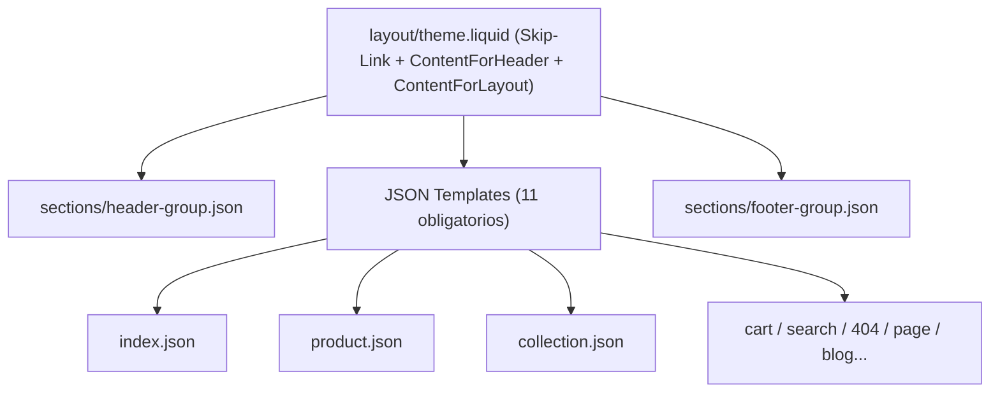
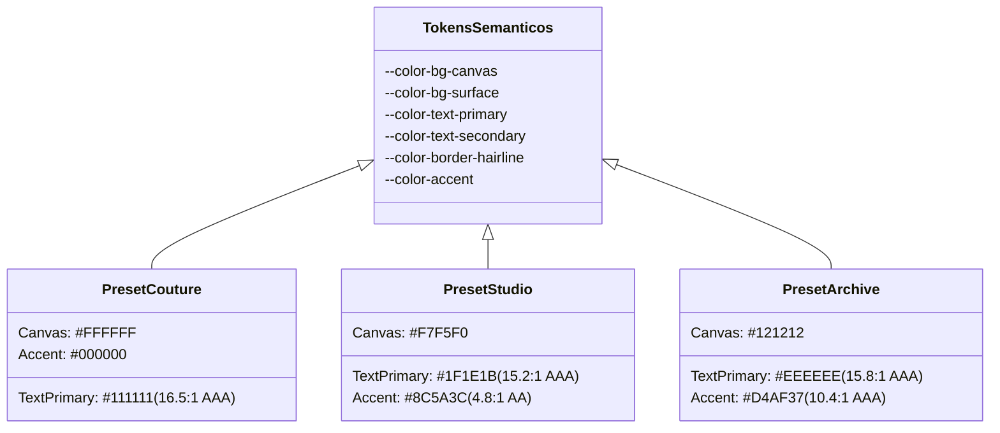

# GEMINI-002: Phase 2 Prep Report

```text
ID: GEMINI-002
Estado: completado
Decision requerida: Aprobacion de la arquitectura de secciones, plantillas JSON, tokens de diseno e interacciones para iniciar la implementacion del theme skeleton en Fase 2.
Resumen en 5 lineas:
1. Se estructura la arquitectura de 16 secciones MVP clasificadas en tres niveles de prioridad con soporte para bloques @app.
2. Se definen las 11 plantillas JSON obligatorias mas gift_card.liquid, cumpliendo estrictamente con Online Store 2.0.
3. Se formula el sistema de tokens semanticos CSS y paletas para 3 presets (Couture, Studio, Archive) con contrastes WCAG AA verificados.
4. Se detallan especificaciones de interaccion accesibles para Header, Búsqueda predictiva, Cart Drawer, Lookbook y Sticky Cart.
5. Se identifican 3 puntos criticos para escalamiento a modelo superior de OpenAI y 4 areas clave para revision editorial con Claude.
```

---

## 1. Section Architecture Matrix (MVP)

Alineado con el principio *Commerce inside storytelling* y la estructura de Online Store 2.0. Cada sección está diseñada para evitar dependencias externas.

### Prioridad 1: Shell & Núcleo Transaccional (Fase 2 Skeleton)

| Sección (`file_name`) | Objetivo Comercial / UX | Bloques Permitidos | Settings Principales | Soporta `@app` | Riesgo Técnico | Riesgo UX / Accesibilidad |
| :--- | :--- | :--- | :--- | :---: | :--- | :--- |
| `header` | Cabecera global (`header-group`). Navegación, búsqueda, cuenta y carrito. | `menu_item`, `mega_menu`, `promo_card` | `logo_width`, `sticky_type`, `menu_layout`, `enable_account_icon`, `show_country_selector` | Sí | Sincronización del web component obligatorio `<shopify-account>`. | Trampa de foco en menú móvil y cierre con Escape. |
| `footer` | Pie global (`footer-group`). Enlaces legales, newsletter, pagos y redes. | `link_list`, `text_block`, `newsletter_block`, `social_icons` | `enable_payment_icons`, `enable_follow_on_shop`, `enable_country_selector`, `color_scheme` | Sí | Carga asíncrona del script Follow on Shop sin bloquear render. | Etiquetas accesibles en campos de formulario y botones. |
| `main-product` | Página de producto (PDP). Galería de medios y conversión. | `title`, `price`, `variant_picker`, `buy_buttons`, `description`, `collapsible_tab`, `complementary_products`, `share`, `rating` | `media_layout` (stacked/carousel), `enable_sticky_info`, `enable_video_looping`, `zoom_type` | **Sí (Obligatorio)** | Cambio de variante dinámico vía Liquid/DOM sin render innecesario. | `aria-live` en cambio de precio/variante; soporte para variantes agotadas. |
| `main-collection` | Página de colección (PLP). Catálogo con filtrado facetado. | `product_card`, `editorial_banner` | `products_per_page`, `columns_desktop`, `columns_mobile`, `enable_filtering`, `enable_sorting`, `filter_type` (drawer/sidebar) | Sí | Mutación de parámetros URL (`URLSearchParams`) al filtrar sin recargar toda la página. | Anuncio accesible del total de resultados filtrados vía `aria-live`. |
| `main-cart-drawer` | Carrito deslizable lateral. Reducción de abandono. | `cart_item`, `free_shipping_bar`, `gift_note`, `cart_upsell` | `show_vendor`, `enable_order_notes`, `free_shipping_threshold`, `empty_cart_collection` | Sí | Manejo de concurrencia y actualización rápida vía Shopify Ajax API (`/cart/change.js`). | Atrapar el foco al abrir; devolver foco al botón activador al cerrar. |

### Prioridad 2: Diferenciadores & Conversión Nativa (Fase 3)

| Sección (`file_name`) | Objetivo Comercial / UX | Bloques Permitidos | Settings Principales | Soporta `@app` | Riesgo Técnico | Riesgo UX / Accesibilidad |
| :--- | :--- | :--- | :--- | :---: | :--- | :--- |
| `shoppable-lookbook` | Fotografía editorial con compra directa sin apps. | `hotspot_pin` (coordenadas X/Y en %, producto vinculado) | `image`, `mobile_image`, `overlay_opacity`, `pin_style`, `card_presentation` | No | Evitar desplazamiento de diseño (CLS) calculando aspect-ratio. | Botones de pines con `aria-expanded` y diálogo accesible con `role="dialog"`. |
| `split-editorial` | Storytelling asimétrico: campaña + texto + micro-tarjeta. | `heading`, `text`, `product_mini_card`, `cta_button` | `layout_ratio` (50/50, 60/40), `media_position`, `color_scheme`, `desktop_height` | No | Carga condicional de imagen/video sin retrasar LCP. | Contraste de texto en superposiciones y jerarquía `h2`/`h3`. |
| `featured-collection` | Descubrimiento curado en Home. | `collection_card`, `editorial_tile` | `collection`, `product_limit`, `columns_desktop`, `enable_carousel`, `show_view_all` | No | Render eficiente con `lazy-loading` en cards fuera de pantalla. | Desplazamiento táctil fluido (scroll-snap) y navegación por flechas con teclado. |
| `sticky-cart-bar` | Barra de compra ergonómica en móvil al hacer scroll. | `quick_variant_selector`, `buy_button` | `enable_mobile_only`, `show_swatches_in_drawer`, `offset_threshold` | No | Escucha eficiente del scroll mediante `IntersectionObserver` (sin eventos scroll JS continuos). | No debe tapar avisos legales, cookies ni botones flotantes de apps. |
| `predictive-search` | Autocompletado rápido desde el Header. | `search_results_group` (productos, colecciones, artículos) | `results_limit`, `show_price`, `show_vendor`, `search_scope` | No | Debounce estricto (300ms) en llamadas a `/search/suggest.json`. | Foco automático en primer resultado con flechas arriba/abajo (`aria-activedescendant`). |

### Prioridad 3: Secciones Editoriales y de Confianza

| Sección (`file_name`) | Objetivo Comercial / UX | Bloques Permitidos | Settings Principales | Soporta `@app` |
| :--- | :--- | :--- | :--- | :---: |
| `hero-editorial` | Apertura de marca, lanzamiento de temporada o colección. | `slide`, `heading`, `subheading`, `button_pair` | `banner_height`, `image_desktop`, `image_mobile`, `text_alignment`, `fetchpriority_high` | No |
| `craftsmanship-timeline` | Manifiesto de origen, materiales o ritual de confección. | `timeline_step` (número, foto, título, descripción) | `layout` (vertical/horizontal), `spacing`, `accent_line` | No |
| `rich-text` | Texto de manifiesto, citas editoriales o avisos. | `caption`, `heading`, `paragraph`, `button` | `max_width`, `alignment`, `color_scheme` | No |
| `faq-accordion` | Resolución de dudas de envío, tallas o cuidados. | `question_item` (pregunta, respuesta en rich_text) | `heading`, `expand_first`, `columns` | Sí |
| `newsletter` | Captura de suscriptores para email marketing. | `heading`, `input_form`, `disclaimer` | `color_scheme`, `form_action` | No |

---

## 2. Template Architecture Matrix

Estructura obligatoria para cumplir con los requerimientos de la Shopify Theme Store:



| Plantilla | Formato | Secciones Recomendadas en Preset Base | Notas de Conversión y Accesibilidad |
| :--- | :---: | :--- | :--- |
| `index.json` | JSON | `hero-editorial`, `featured-collection`, `shoppable-lookbook`, `split-editorial`, `craftsmanship-timeline`, `newsletter` | LCP protegido: solo el primer hero lleva `fetchpriority="high"`. Los demás usan `loading="lazy"`. |
| `product.json` | JSON | `main-product`, `complementary-products`, `product-recommendations`, `faq-accordion` | Carga inicial obligatoria de la primera variante disponible (`selected_or_first_available_variant`). Bloque `@app` para reseñas. |
| `collection.json` | JSON | `main-collection`, `split-editorial` (banner de colección curado) | Atributos facetados nativos; URL canónica preservada; toggle de densidad de cuadrícula accesible. |
| `list-collections.json` | JSON | `main-list-collections` | Catálogo de colecciones ordenable; tarjetas con títulos no truncados. |
| `cart.json` | JSON | `main-cart-items`, `product-recommendations` | Soporte nativo de `cart.taxes_included`, desglose de notas, checkout acelerado y selling plans. |
| `search.json` | JSON | `main-search` | Filtros facetados sobre el objeto `search`; estado vacío (*empty state*) guiado hacia colecciones populares. |
| `page.json` | JSON | `main-page`, `rich-text` | Tipografía óptima para lectura prolongada (65-75 caracteres por línea). |
| `page.contact.json` | JSON | `main-page-contact` | Campos obligatorios asociados con `<label for="...">`; mensajes de error o confirmación con `aria-live`. |
| `blog.json` | JSON | `main-blog` | Tarjetas con `article.excerpt_or_content` (nunca `article.content` crudo); paginación accesible. |
| `article.json` | JSON | `main-article`, `related-articles`, `featured-product` | Encabezado jerárquico `h1`; fecha legible mediante `article.published_at` (requisito Theme Store). |
| `404.json` | JSON | `main-404`, `featured-collection` | Reducción de rebote: barra de búsqueda prominente y sugerencias de productos destacados. |
| `password.json` | JSON | `main-password` | Formulario de password protegido por Shopify con modal accesible y captura de correo. |
| `gift_card.liquid` | Liquid | N/A (Plantilla Liquid especial independiente) | Soporte obligatorio para Apple Wallet Pass, formulario de destinatario (`recipient`) y botón de impresión. |

---

## 3. Design Tokens Proposal (Variables Semánticas)

Arquitectura basada en CSS Custom Properties nativas sin Sass, organizadas bajo `:root` y con soporte de temas de color conmutables `[data-color-scheme="..."]`.

### Tokens Semánticos Globales
```css
:root {
  /* Escala de Espaciado Fluido */
  --space-unit: clamp(1rem, 0.85rem + 0.75vw, 1.5rem);
  --space-2xs: calc(var(--space-unit) * 0.25); /* ~4px */
  --space-xs: calc(var(--space-unit) * 0.5);   /* ~8px */
  --space-sm: calc(var(--space-unit) * 0.75);  /* ~12px */
  --space-md: var(--space-unit);               /* ~16-24px */
  --space-lg: calc(var(--space-unit) * 1.5);   /* ~24-36px */
  --space-xl: calc(var(--space-unit) * 2.5);   /* ~40-60px */
  --space-2xl: calc(var(--space-unit) * 4);    /* ~64-96px */

  /* Límites de Contenedor */
  --container-max-width: 1440px;
  --container-narrow-width: 880px;
  --container-padding: clamp(1rem, 4vw, 3.5rem);

  /* Bordes & Curvaturas Hairline */
  --border-width: 1px;
  --radius-subtle: 2px;
  --radius-card: 4px;
  --radius-full: 9999px;

  /* Transiciones y Motion (Sutil y Táctil) */
  --motion-duration-fast: 150ms;
  --motion-duration-base: 250ms;
  --motion-duration-slow: 400ms;
  --motion-easing-standard: cubic-bezier(0.16, 1, 0.3, 1);
  --motion-easing-out: cubic-bezier(0, 0, 0.2, 1);
}

/* Modo Accesible: Reduced Motion */
@media (prefers-reduced-motion: reduce) {
  :root {
    --motion-duration-fast: 0ms;
    --motion-duration-base: 0ms;
    --motion-duration-slow: 0ms;
  }
}
```

### Paletas por Preset y Verificación de Contraste (WCAG 2.1/2.2 AA)



| Preset | Rol de Color | Valor Hex / RGBA | Ratio Contraste vs Fondo | Estado WCAG AA |
| :--- | :--- | :--- | :---: | :---: |
| **Couture** | Fondo Canvas | `#FFFFFF` | N/A | Base |
| | Superficie / Tarjetas | `#F9F9F9` | N/A | Base |
| | Texto Principal | `#111111` | **16.5:1** | Cumple AAA (min 4.5:1) |
| | Texto Secundario / Metas | `#555555` | **7.5:1** | Cumple AAA (min 4.5:1) |
| | Bordes Hairline | `rgba(17, 17, 17, 0.09)` | 1.2:1 | Válido (borde estructural) |
| | Acento / CTA Principal | `#000000` | **21:1** | Cumple AAA |
| **Studio** | Fondo Canvas | `#F7F5F0` (Lino cálido) | N/A | Base |
| | Superficie / Tarjetas | `#EFECE4` (Arena suave) | N/A | Base |
| | Texto Principal | `#1F1E1B` (Carbón café) | **15.2:1** | Cumple AAA |
| | Texto Secundario | `#636058` | **5.4:1** | Cumple AA |
| | Bordes Hairline | `rgba(31, 30, 27, 0.12)` | 1.3:1 | Válido |
| | Acento Terracota | `#8C5A3C` | **4.8:1** | Cumple AA |
| **Archive** | Fondo Canvas | `#121212` (Modo oscuro) | N/A | Base |
| | Superficie / Tarjetas | `#1A1A1A` | N/A | Base |
| | Texto Principal | `#EEEEEE` | **15.8:1** | Cumple AAA |
| | Texto Secundario | `#9E9E9E` | **6.2:1** | Cumple AA |
| | Bordes Hairline | `rgba(255, 255, 255, 0.12)` | 1.3:1 | Válido |
| | Acento Muted Brass | `#D4AF37` | **10.4:1** | Cumple AAA |

> [!WARNING]
> **Punto de atención sobre contraste en `Studio`:** Si el merchant cambia el color de fondo a un tono arena más oscuro sin ajustar el texto secundario `#636058`, el contraste podría caer por debajo de 4.5:1. Recomendamos que el schema del Theme Editor aplique controles de advertencia o use la función nativa de esquemas de color de Shopify (*Color Schemes*) que asocia pares controlados de fondo y texto.

---

## 4. Interaction Specification

Especificaciones técnicas para Web Components en vanilla JS sin dependencias:

### 1. Header & Mobile Navigation (`<mobile-nav-drawer>`)
- **Apertura:** Botón hamburguesa con `aria-expanded="false"`, `aria-controls="mobile-nav"`.
- **Comportamiento:** Panel deslizable desde la izquierda o bottom-sheet; aplica `inert` al resto del DOM (`main`, `footer`).
- **Navegación:** Enlaces multinivel con botones colapsables (`aria-expanded`).
- **Cierre:** Tecla `Escape`, botón de cierre explícito o clic en overlay translúcido. Al cerrar, devuelve el foco inmediatamente al botón detonador.

### 2. Búsqueda Predictiva (`<predictive-search>`)
- **Disparador:** Botón de lupa en cabecera abre modal/drawer con foco automático en `<input type="search">`.
- **Entrada:** Debounce de 300ms antes de consultar `/search/suggest.json?resources[type]=product,collection,page,article`.
- **Accesibilidad:** Resultados agrupados en listas semánticas. Lector de pantalla notificado vía `<div aria-live="polite" class="visually-hidden">`. Soporte para flechas arriba/abajo y selección con `Enter`.

### 3. Cart Drawer (`<cart-drawer>`)
- **Disparador:** Añadir al carrito desde PDP/PLP o clic en icono de bolsa.
- **Microinteracciones:**
  - Barra de progreso de envío gratis: actualiza visualmente el porcentaje restante en tiempo real.
  - Ajuste de cantidad (+ / - / eliminar) con feedback asíncrono y bloqueo de botón temporal para evitar llamadas múltiples simultáneas.
  - Sección de notas del pedido desplegable con guardado mediante debounce en `/cart/update.js`.
- **Accesibilidad:** Foco atrapado en el drawer; anuncio por lector de pantalla con `aria-live="assertive"` cuando se añade un artículo nuevo.

### 4. Quick Add & Variant Flyout (`<quick-add-button>`)
- **Caso 1 (Producto sin variantes / 1 variante):** Hace POST directo a `/cart/add.js` y abre el `cart-drawer`.
- **Caso 2 (Múltiples variantes):** Abre un sub-drawer o popover inferior rápido con swatches y tallas disponibles. No redirige a PDP salvo que falte información crítica (ej. propiedades de personalización).

### 5. Variant Picker con Swatches (`<variant-selects>`)
- **Implementación:** Radio buttons semánticos con `role="radiogroup"` y `aria-label="Seleccionar Color"`.
- **Swatches nativos:** Soporte para `swatch.color` y `swatch.image` con fallback a valor de texto si la tienda no tiene swatches configurados.
- **URL y Estado:** Actualización instantánea de precio, disponibilidad, botones de compra y cambio de URL usando `history.replaceState` sin recargar la página.

### 6. Shoppable Lookbook Hotspots (`<lookbook-hotspot>`)
- **Estructura:** Botón circular posicionado con `top: calc(...)` y `left: calc(...)` en porcentajes.
- **Accesibilidad:** `<button aria-haspopup="dialog" aria-expanded="false" aria-label="Ver producto: Nombre">`.
- **Interacción:** Al hacer clic o presionar `Enter`, despliega una micro-tarjeta de producto flotante con imagen, título, precio y botón de compra directa. Si el viewport corta la tarjeta, el script invierte la dirección del popover (arriba/abajo o izquierda/derecha).

### 7. Sticky Mobile Cart Bar (`<sticky-cart-bar>`)
- **Activación:** Conectado mediante un `IntersectionObserver` al botón de compra principal del formulario de producto.
- **Aparición:** Cuando el botón principal sale del viewport superior al hacer scroll hacia abajo, la barra se desliza suavemente desde el fondo (`translateY(0)`).
- **Contenido:** Imagen miniatura, título truncado, precio y botón "Añadir al carrito" que respeta la variante actualmente seleccionada.

---

## 5. QA Plan Integral

Checklist de verificación previa a la Fase 4:

### 1. Shopify Theme Check
- [ ] Ejecutar `shopify theme check` periódicamente durante la Fase 2 y 3.
- [ ] **0 errores críticos (offenses):** Sin tags obsoletos, sin HTML desbalanceado, schemas JSON válidos, assets nombrados correctamente.

### 2. Lighthouse & Core Web Vitals (Móvil Emulado)
- [ ] Performance Score promedio **≥ 60** (con objetivo de diseño **≥ 90**).
- [ ] LCP < 2.5s en móvil con emulación de red 4G lenta.
- [ ] CLS < 0.1 en todas las plantillas (prohibidos cambios de layout al cargar imágenes o fuentes).
- [ ] INP < 200ms en interacciones de carrito, filtros y swatches.

### 3. Accesibilidad Automatizada & Manual (WCAG 2.1/2.2 AA)
- [ ] Auditoría con **axe-core** y **WAVE** en Home, Producto y Colección sin fallos de contraste o formularios.
- [ ] Prueba manual completa navegando **solo con teclado** (Tab, Shift+Tab, Enter, Space, Escape, Flechas).
- [ ] Verificación de `:focus-visible` claramente visible en modo oscuro y claro.
- [ ] Prueba de lectura con VoiceOver (macOS/iOS) y NVDA (Windows) para comprobar que `aria-live` anuncia cambios de carrito y variantes.

### 4. Responsive & Ergonomía Móvil
- [ ] Viewports probados: `360x740` (Android económico), `390x844` (iPhone estándar), `768x1024` (iPad vertical), `1440x900` (Laptop).
- [ ] Todos los botones de acción principal en móvil tienen un área táctil mínima de **44x44 px**.
- [ ] Ninguna tabla o bento-grid produce desbordamiento horizontal accidental (`overflow-x: scroll` no controlado en viewport general).

### 5. Edge Cases Comerciales de Shopify
- [ ] Producto con 1 sola variante vs. producto con 3 opciones y 100 variantes.
- [ ] Variantes agotadas (*Sold out*) y combinaciones no existentes (*Unavailable*).
- [ ] Producto en descuento (precio normal tachado + precio rebajado + badge de ahorro).
- [ ] Producto con precio por unidad (*Unit pricing* para normativa europea).
- [ ] Producto con planes de venta / suscripción asignados.
- [ ] Carrito con 50+ artículos y carrito vacío (*Empty state* con CTA).
- [ ] Búsqueda sin resultados sugeridos (*No results found* con recomendaciones).
- [ ] Selector de moneda e idioma conmutando sin perder el estado del carrito.

---

## 6. Riesgos, Puntos de Decisión y Recomendaciones de Escalamiento

### Riesgos de Theme Store & Scope
1. **Riesgo de Aceptación por "Uniqueness" insuficiente:** Si el esqueleto de secciones no impone una dirección visual evidente, los revisores de Shopify podrían considerarlo una variación estética de Dawn.
   - *Mitigación:* Implementar el encuadre *hairline*, el ritmo editorial asimétrico y el lookbook con hotspots desde la primera versión de la demo.
2. **Riesgo de Sobrecarga de Scope en Fase 2:** Intentar codificar todas las 16 secciones antes de validar el shell básico.
   - *Mitigación:* Dividir la Fase 2 en: **Fase 2A (Shell, Header, Footer, Theme.liquid, Tokens CSS)** y **Fase 2B (Main-Product, Main-Collection, Cart-Drawer)**.

---

### Decisiones Abiertas para Codex y el Usuario
1. **Nombre Definitivo del Tema:** Confirmar que abandonamos `Atelier` para evitar duplicidad con el tema gratuito de Shopify. Candidatos recomendados para votación:
   - **Loom** (evoca tejido, confección y estructura artesanal).
   - **Aria** (evoca ligereza, elegancia y espacio).
   - **Forma** / **Frame** (evoca arquitectura y encuadre editorial).
2. **Preset Principal de Desarrollo Inicial:** Se sugiere iniciar el desarrollo local sobre el preset **Couture** (por ser el más neutro y de mayor rigor en contraste), para luego derivar **Studio** y **Archive**.
3. **Estrategia de Almacenamiento de Tokens:** Definir si los tokens de color se inyectan en `<head>` vía un snippet `snippets/css-variables.liquid` o si se estructuran como clases utilitarias semánticas.

---

### Recomendaciones de Escalamiento a Modelo Superior de OpenAI (`ESCALATE_MODEL_RECOMMENDED`)

Recomendamos que Codex utilice un modelo superior (o active modo de razonamiento profundo) en los siguientes 3 puntos críticos de arquitectura:

1. **Diseño de la Arquitectura CSS y Sistema de Variables (`snippets/css-variables.liquid`):**
   - *Motivo:* Definir cómo los ajustes de `settings_schema.json` y los *Color Schemes* nativos de Shopify se convierten en variables CSS eficientes sin duplicar código ni generar re-renders.
2. **Arquitectura del Cart Drawer y Ajax State Management:**
   - *Motivo:* Manejar de forma robusta la sincronización asíncrona de inventario, atributos de carrito (notas, regalos), selling plans y compatibilidad con checkout acelerado sin colisiones de scripts.
3. **Lógica de Variantes y Swatches en `main-product`:**
   - *Motivo:* El manejo del árbol de opciones de variantes en Liquid/JS debe soportar variantes no disponibles, cambios de medios y actualización de URL respetando estrictamente las guías oficiales de Shopify sin scripts externos.

---

### Recomendaciones de Uso para Claude (Revisión Editorial y UX)

Recomendamos delegar en Claude las siguientes tareas específicas para optimizar tokens y asegurar un acabado de clase mundial:

1. **Revisión de Labels y Helper Texts de Theme Settings:**
   - *Objetivo:* Auditar todos los textos de configuración en `settings_schema.json` y esquemas de sección para que sigan la terminología oficial de Shopify, sean intuitivos para merchants no técnicos y proyecten una calidad premium.
2. **Redacción de Empty States, Placeholders y Mensajes de Error:**
   - *Objetivo:* Afinar el tono de los mensajes del carrito vacío, búsqueda sin resultados, formularios de contacto y avisos de stock para que mantengan una voz refinada pero clara.
3. **Revisión Editorial de la Documentación para Merchants:**
   - *Objetivo:* En Fase 4, redactar y estructurar la guía de instalación, tutoriales de configuración de presets y preguntas frecuentes para la submission en Shopify Theme Store.
