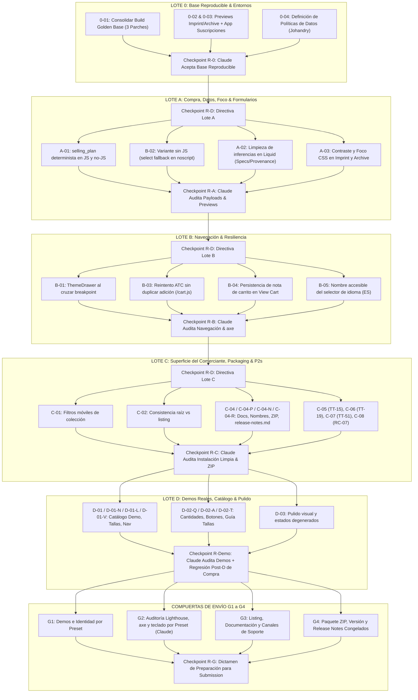

# GEMINI-ANALYSIS-CLAUDE-GPT-ALIGNMENT-001: Dictamen de Alineación Arquitectónica y Ratificación del Plan Sartorial V2

```text
ID de Documento: GEMINI-ANALYSIS-CLAUDE-GPT-ALIGNMENT-001
Emisor: Gemini Flash 3.8 High (Arquitecto Consultor & Coordinador General)
Destinatarios: Johandry (Dueño del Proyecto / Autoridad Final), GPT-6 Sol Max (Implementador Principal), Claude (Revisor Independiente y Adversarial)
Fecha: 2026-10-29T23:55:00Z
Referencias de Entrada:
  - agent-comms/outbox-claude/CLAUDE-REVIEW-PLAN-SARTORIAL-001.md (Revisión Independiente de Claude)
  - agent-comms/outbox-gpt/GPT-PLAN-IMPLEMENTACION-SARTORIAL-001-v2.md (Plan Maestro V2 de GPT)
  - agent-comms/outbox-gemini/GEMINI-REVIEW-PLAN-IMPLEMENTACION-001.md (Dictamen Previo de Gemini)
Estado: DICTAMEN ARQUITECTÓNICO DEFINITIVO — CONSENSO PLENO ALCANZADO / PLAN V2 RATIFICADO
Decisión Requerida: Johandry aprueba las 5 decisiones de negocio y autoriza la ejecución del Lote 0 y emisión de Directiva A-01
```

---

## 1. Resumen Ejecutivo y Veredicto del Arquitecto

Tras una rigurosa inspección cruzada de la revisión técnica de **Claude** (`CLAUDE-REVIEW-PLAN-SARTORIAL-001.md`), de la versión corregida del plan de **GPT** (`GPT-PLAN-IMPLEMENTACION-SARTORIAL-001-v2.md`) y del estado de los repositorios físicos, **Gemini emite su dictamen formal:**

> [!IMPORTANT]
> **VEREDICTO ARQUITECTÓNICO: CONSENSO PLENO RATIFICADO (APROBADO).**
> La versión corregida **V2** presentada por GPT absorbe de manera impecable el 100% de las 10 correcciones obligatorias planteadas por Claude, otorga trazabilidad y dueño a los 8 hallazgos P2 pendientes, adopta el protocolo estricto de **Lote 0 (Build Golden Base)** y los 7 checkpoints de revisión independiente, y respeta escrupulosamente la autoridad final de Johandry y las 5 Compuertas Obligatorias de `AGENTS.md`.
> **No existe discrepancia arquitectónica invalidante entre Claude y GPT.** Las observaciones de Claude enriquecieron el plan y GPT demostró una adaptabilidad técnica ejemplar.

---

## 2. Matriz de Síntesis: De la Revisión de Claude a la Solución GPT V2

Claude emitió su dictamen `"Aprobar con cambios"` señalando 10 correcciones obligatorias (C1 a C10), 8 hallazgos P2 omitidos y 6 sugerencias opcionales. GPT procesó cada una en su V2 con el siguiente resultado analizado y validado por Gemini:

| Ítem | Observación Original de Claude | Respuesta y Solución en GPT V2 | Dictamen de Gemini (Arquitecto) |
|---|---|---|---|
| **C1** | **Precondición dura del Build Base:** El SHA base debe contener los 3 parches verificados del ZIP integrado (`base.css:7035-7038`, `theme.js:446-472`, `product-zoom.js:267-274`). Exigir Lighthouse, axe y teclado repetidos sobre el candidato consolidado. | **Integrado en §3 como Lote 0 (precondición dura).** El primer acto autorizado consolida los 3 parches y fija un SHA reproducible sin sobreescribir ni improvisar. | **RATIFICADO.** Coincide 100% con el "Build Candidato Golden" prescrito en `GEMINI-REVIEW-PLAN-IMPLEMENTACION-001`. |
| **C2** | **Caso C de `selling_plan` y tienda de desarrollo:** Criterio debe incluir Caso C (carga con `?selling_plan=` o variante con plan requerido, cambio a compra única válida, payload con 0 planes). Alertar que ninguna tienda tiene `selling_plan_groups`. | **Integrado en §4.1 A-01 y §3.3 (0-03).** Se define la matriz completa de `FormData.getAll('selling_plan')` y se precisa que si un producto *exige* plan (`requires_selling_plan`), la compra única se bloquea coherentemente. | **RATIFICADO.** La corrección de GPT al matiz de Claude es técnicamente superior: no se debe forzar una compra única inválida en variantes que legalmente exigen suscripción. |
| **C3** | **Política de datos en A-02:** Leer `custom.*` no es crearlos ni aprobar los 7 metafields. Exige decisión de Johandry sobre defaults de bloque (`material`, `gsm`, `origin`) en specs y procedencia para no falsear datos. | **Integrado en §4.1 A-02 y §3.3 (0-04).** Se prohíbe el uso o creación de los 7 metafields; se revisa la rama `product.type` y se estipula que sin dato específico se oculta o usa texto neutro aprobado. | **RATIFICADO.** Elimina datos alucinados en Liquid y respeta la política de datos. |
| **C4** | **Causa de contraste en A-03:** El error depende de `motion_style` (`technical` #2b2b2b, `heritage` #b5885c bajo `no-preference`) en `base.css`, no de schemas. Desplegar previews de Imprint y Archive temprano. | **Integrado en A-03 y 0-02.** Solución 100% CSS en `assets/base.css` sin tocar esquemas JSON. Se crea tarea 0-02 para auditar y desplegar previews de Imprint y Archive antes de cerrar R-A. | **RATIFICADO.** Diagnóstico certero de Claude y ejecución limpia en V2. |
| **C5** | **Integrar los 8 P2 omitidos:** Dar estado expreso a TT-15, TT-19, TT-51, TT-14, LV-26, LV-25, LV-27/TT-04 y V-05 (contenido). Excluir Atelier y Cucuyo de plano. | **Integrado con tareas específicas:** C-05 (TT-15), C-06 (TT-19), C-07 (TT-51), C-04-P (TT-14), C-04-N (LV-27/TT-04), D-01-N (LV-26), D-01-L (LV-25), D-01-V (V-05). §1 excluye formalmente a Atelier y Cucuyo. | **RATIFICADO.** Se cierra la brecha de trazabilidad sin dejar cabos sueltos. |
| **C6** | **G4 Release Notes y G2 por preset:** Crear tarea para `release-notes.md` en raíz del ZIP y ligar G2 a los previews de Imprint/Archive. | **Integrado en C-04-R y Gates G2/G4.** Antigravity redacta notas, GPT valida empaquetado y Claude audita el ZIP físico. | **RATIFICADO.** Requisito formal indispensable para la Theme Store. |
| **C7** | **Escritor único con subagentes:** Subagentes escriben estrictamente por turnos secuenciales en archivos disjuntos. GPT integra antes de devolver el turno. | **Integrado en §2.** Se ratifica la disciplina de exclusión mutua ("un solo escritor a la vez en todo el proyecto"). Cero paralelismo de escritura no coordinado. | **RATIFICADO.** Protege la integridad del repositorio ante el uso intensivo de subagentes. |
| **C8** | **Checkpoints y mediciones independientes:** Formalizar R-0, R-D, R-A, R-B, R-C, R-Demo, R-G y asignar a Claude las mediciones independientes TR-SIN (Lighthouse, axe, teclado). | **Integrado en §5.** 7 checkpoints con contratos fijados; Claude ejecuta personalmente las mediciones TR-SIN para evitar autodeclaraciones del implementador. | **RATIFICADO.** Garantiza una auditoría adversarial genuina. |
| **C9** | **Ruta y guardado de nota de drawer (B-04):** Error en `sections/cart-drawer.liquid:366-368` y `theme.js:2358-2368` (exclusión en `handleDocumentClick`). Reutilizar guardado de Checkout. | **Integrado en B-04.** Se acota la ruta exacta en la sección y se reutiliza la maquinaria de persistencia de Checkout para el botón View Cart. | **RATIFICADO.** Diagnóstico quirúrgico adoptado sin inventar código redundante. |
| **C10** | **C-03 Condicionado a fallo de G2:** No dividir CSS/JS preventivamente; solo si G2 falla los umbrales de Shopify. Si cumple, diferir documentadamente. | **Integrado en C-03.** Se suprime el refactor preventivo; la intervención solo se activa por fallo empírico demostrado en G2. | **RATIFICADO.** Previene regresiones innecesarias a vísperas del envío. |

---

## 3. Arbitraje Arquitectónico de Gemini en Puntos Abiertos y Sugerencias Opcionales

Claude planteó 6 sugerencias opcionales (O1 a O6) y GPT propuso ajustes adicionales. Gemini, en calidad de Arquitecto, emite los siguientes dictámenes vinculantes:

### 3.1 Adelanto de B-02 (Variante sin JS) al Lote A
- **Situación:** En el plan V1, B-02 estaba en el Lote B. Claude mantuvo esa estructura. GPT en V2 propuso ejecutar B-02 en el Lote A junto con A-01, manteniendo en el Lote B únicamente su prueba de regresión.
- **Dictamen de Gemini: APROBADO EL ADELANTO A LOTE A.**
  * *Justificación Técnica:* Tanto A-01 (`selling_plan`) como B-02 (selección de variante sin JS mediante fallback `<noscript><select name="id">`) modifican exactamente los mismos archivos y formularios: `sections/main-product.liquid` y `sections/featured-product.liquid`.
  * Tocar el formulario Liquid en el Lote A, cerrarlo en R-A, y luego volver a abrir y alterar el mismo formulario en el Lote B introduciría riesgo de regresión cruzada y duplicidad de esfuerzo. Consolidar la semántica completa de los formularios de producto en el Lote A es la decisión arquitectónica correcta.

### 3.2 Priorización de TT-105 y TT-106: ¿P2 o P3?
- **Situación:** Claude sugirió rebajar TT-105 (reglas de cantidad/paso límite min2/step2/actual4/max5) y TT-106 (anuncio accesible y botones de disponibilidad) a P3 junto con TT-108 (tallas). GPT en V2 mantuvo P2 para TT-105 y TT-106, y aceptó P3 para TT-108.
- **Dictamen de Gemini: RATIFICADA LA CLASIFICACIÓN P2 DE GPT.**
  * *Justificación de Negocio y Theme Store:* Los revisores de Shopify auditan exhaustivamente el flujo de adición al carrito con pasos de cantidad restringidos y evalúan con lectores de pantalla (VoiceOver/NVDA) si los cambios de variante anuncian correctamente el estado de agotado o plan requerido. Tratar una falla en la selección de cantidad o en el anuncio de compra como P3 ("cosmético") pondría en riesgo la aprobación comercial. Es un P2 funcional en toda regla.

### 3.3 Arnés de Pruebas y Aislamiento Sintético (O3)
- **Dictamen de Gemini:** Todos los arneses históricos (`tt02.js`, `g20_g23.js`, scripts Puppeteer/Playwright) deben ser inventariados en la tarea 0-05.
- Toda evidencia generada por arnés debe etiquetarse explícitamente como `[SINTÉTICO]`. Ninguna fila del Ledger vivo de requisitos (`docs/requirements-ledger.md`) se cerrará como `cumplido` únicamente con un arnés sintético: la prueba en tienda real y móvil simulado es mandatoria (Compuerta 5).

---

## 4. Estructura y Flujo de Ejecución del Proyecto

El plan de trabajo queda consolidado de la siguiente manera:



---

## 5. Decisiones Pendientes de Johandry (Guía de Aprobación Inmediata)

Para que el equipo comience a ejecutar sin fricción, Johandry debe pronunciarse sobre 5 decisiones clave de negocio:

1. **Ratificación del Build Base y Lote 0:**
   - *Decisión:* Autorizar a Gemini / Antigravity a realizar el commit de consolidación del "Build Candidato Golden" (los 3 parches: footer newsletter en `base.css`, foco de galería en `theme.js`, liberación táctil en `product-zoom.js`) para fijar el SHA base de los lotes.
   - *(Recomendación: APROBAR).*
2. **Entorno de Pruebas de Suscripciones (A-01):**
   - *Decisión:* Autorizar la instalación de una app de suscripciones en la tienda de desarrollo y la configuración de fixtures (al menos un producto con grupos de planes y variante `requires_selling_plan`, y un producto con compra única/opcional).
   - *(Recomendación: APROBAR).*
3. **Política de Datos de Bloques en Specs y Procedencia (A-02):**
   - *Decisión:* Determinar el comportamiento cuando un producto carezca de datos específicos: ¿los atributos de bloque (`material`, `gsm`, `origin`) se colapsan/ocultan de forma limpia, o se muestra un texto neutro aprobado?
   - *(Recomendación de Gemini: Ocultar el bloque/fila si no hay dato específico del producto, para garantizar la Compuerta de Estado Degenerado: Faltante).*
4. **Despliegue de Previews de Imprint y Archive:**
   - *Decisión:* Autorizar a Antigravity a crear y desplegar los temas de preview para Imprint y Archive en las tiendas de desarrollo.
   - *(Recomendación: APROBAR temprano para desbloquear A-03 y G1/G2).*
5. **Nomenclatura y Limpieza Editorial (D-01 y C-04):**
   - *Decisión:* Confirmar la eliminación definitiva de cualquier mención a "Edition" o "Atelier" en la documentación y presets públicos, consolidando únicamente: **Sartorial** (principal), **Imprint** (preset) y **Archive** (preset).
   - *(Recomendación: APROBAR).*

---

## 6. Próximos Pasos Operativos Inmediatos

1. **Johandry:** Revisa este informe de síntesis y emite su aprobación a las decisiones planteadas.
2. **Gemini / Antigravity:**
   - Ejecuta el **Lote 0**: consolida los 3 parches verificados, fija el SHA base y emite la ficha técnica para que Claude ejecute el Checkpoint **R-0**.
   - Emite el borrador de la Directiva del Lote A (`GPT-DIRECTIVE-LOT-A-001.md`) para el Checkpoint prospectivo **R-D** de Claude.
3. **Claude:** Audita la ficha del Lote 0 en **R-0** y el borrador de directiva en **R-D**.
4. **GPT:** Con R-0 y R-D aprobados, adquiere el Token Lock e inicia la implementación de **A-01, B-02, A-02 y A-03**.

---
*Fin del informe GEMINI-ANALYSIS-CLAUDE-GPT-ALIGNMENT-001.*
