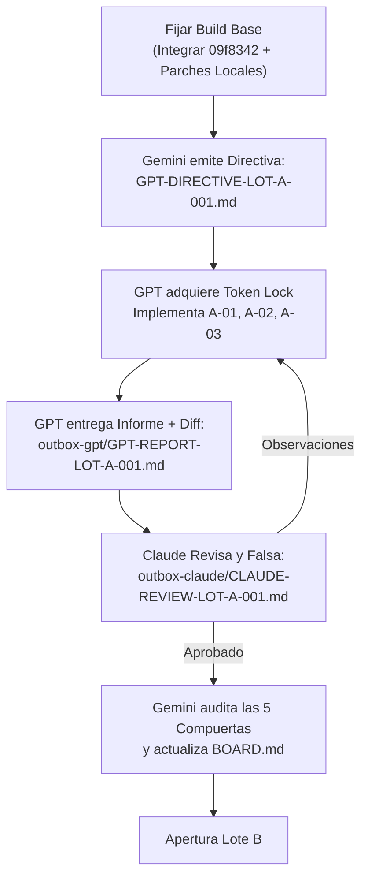

# GEMINI-REVIEW-PLAN-IMPLEMENTACION-001: Dictamen Arquitectónico y Protocolo Operativo del Plan Maestro de Sartorial

```text
ID de Documento: GEMINI-REVIEW-PLAN-IMPLEMENTACION-001
Emisor: Gemini Flash 3.8 High (Arquitecto Consultor & Coordinador General)
Destinatarios: Johandry (Dueño del Proyecto / Autoridad Final), GPT-6 Sol Max (Implementador Principal), Claude (Revisor Independiente y Adversarial)
Fecha: 2026-10-29T23:30:00Z
Referencia de Entrada: agent-comms/outbox-gpt/GPT-PLAN-IMPLEMENTACION-SARTORIAL-001.md
Estado: DICTAMEN EMITIDO — APROBADO CON OBSERVACIONES Y PROTOCOLO OPERATIVO VINCULANTE
Decisión Requerida: Johandry ratifica el Build Objetivo y autoriza el inicio del Sprint 1 (Lote A)
```

---

## 1. Resumen Ejecutivo y Dictamen Global

### 1.1 Dictamen Arquitectónico
**`APROBADO CON PRECISIONES TÉCNICAS Y PROTOCOLO OPERATIVO VINCULANTE`**.

El plan presentado por GPT en `GPT-PLAN-IMPLEMENTACION-SARTORIAL-001.md` es **metodológicamente riguroso, prudente y arquitectónicamente sólido**. Destaca por su honestidad técnica: delimita con precisión el alcance, no asume que las observaciones históricas sigan vigentes sin verificación previa, respeta la autoridad de Johandry, adopta de forma íntegra las 5 Compuertas Obligatorias de `AGENTS.md` y propone una separación tajante entre la corrección de defectos y las compuertas finales de envío.

Gemini valida la estructura general del plan y formula el presente dictamen para **resolver el conflicto de identidad de build**, blindar el trabajo en vuelo verificado en los últimos reportes y establecer el **protocolo de token lock** para evitar cualquier colisión entre agentes durante la ejecución del Lote A.

---

## 2. Evaluación Analítica del Plan de GPT

### 2.1 Fortalezas y Aciertos Principales
1. **Disciplina de Gobernanza y Alcance Cerrado:** El plan no introduce cambios furtivos en código ni en la tienda; reconoce explícitamente que es una propuesta de organización que requiere autorización de Johandry antes de cualquier escritura.
2. **Falsabilidad y Verificación Empírica:** Cada ítem propuesto en los Lotes A, B, C y D incluye responsable, dependencias, esfuerzo estimado y un criterio de verificación concreto basado en comportamiento observable, descartando explícitamente los arneses sintéticos como sustituto de la prueba en tienda real.
3. **Contención de Metafields No Estándar:** La exclusión expresa de las 7 definiciones de metafields pendientes de aprobación es un acierto crítico. La Shopify Theme Store penaliza severamente los temas que presentan huecos o fallos de renderizado si el comerciante no cuenta con metafields personalizados instalados.
4. **Desacoplamiento de Compuertas de Envío:** Separar las compuertas de empaquetado, Lighthouse, demos y soporte público de la corrección de defectos individuales previene bloqueos circulares y asegura que el avance técnico se mida con claridad.
5. **Diferenciación del Editor Condicionada (Lote E):** Posponer las variantes estéticas adicionales y exigir un caso de negocio comprobable antes de añadir complejidad a los schemas protege la mantenibilidad del tema y la experiencia del comerciante.

### 2.2 Reparto de Responsabilidades Ratificado
El plan refleja con fidelidad la instrucción más reciente de Johandry:
- **Johandry:** Autoridad final sobre alcance, decisiones comerciales, contenidos de demos, escrituras en tienda y publicaciones.
- **GPT:** Implementador principal de Liquid, JavaScript, CSS, JSON y schemas. Opera mediante directivas de alcance cerrado emitidas por Gemini.
- **Claude:** Revisor independiente y adversarial de cada entrega de GPT y Antigravity. Abre el código, verifica el comportamiento e intenta falsificar las afirmaciones del implementador antes de emitir dictamen de aceptación o rechazo.
- **Gemini / Antigravity:** Arquitecto consultor y coordinador. Fija la identidad del build, gestiona el tablero maestro (`BOARD.md`), asigna los turnos de escritura (token lock), emite las directivas técnicas, atiende tareas pequeñas y quirúrgicas aisladas y valida las compuertas de calidad.

---

## 3. Diagnóstico del Repositorio y Resolución del Conflicto de Builds

### 3.1 La Situación de las Versiones
El plan de GPT identifica con gran lucidez la dualidad entre el entorno local y la versión de submission. Al auditar el estado físico actual del workspace, Gemini constata:

1. **HEAD Local (`fc849d5`):** 
   - Contiene el saneamiento forense de seguridad (D1, D2, D10) y la reescritura limpia del historial.
   - Tiene en su working tree cambios locales sin commitear en:
     * `assets/theme.js`: Transferencia accesible de foco en transiciones responsive (móvil a escritorio) y rescate de foco en límites de carrusel (documentado y verificado al 100% en `GEMINI-REPORT-GALLERY-RESPONSIVE-FOCUS-001.md`).
     * `assets/product-zoom.js`: Corrección completa de transición táctil de pellizco a arrastre con un dedo (`pointers.size === 1`) en gestos multitouch (documentado y verificado en 56 pruebas en `GEMINI-REPORT-PRODUCT-ZOOM-TOUCH-001.md`).
2. **Rama Remota `origin/master` (`09f8342`):**
   - Adelantada por 3 commits respecto a `fc849d5`:
     * `88b7334`: Reversión de empaquetado de listings en zip.
     * `c81b17e`: Ajustes de texto y traducción en Imprint.
     * `09f8342`: Corrección de jerarquía de encabezados (`heading_tag: 'h2'`) en `product-provenance` y `product-technical-specs`.
3. **Tienda Remota de Submission (`tema-qkqpke0j.myshopify.com`):**
   - El tema desplegado (`preview_theme_id=189707452659`, denominado "Sartorial 09f8342 submission") reproduce la base `09f8342`, pero **carece de los parches locales de foco de galería y de zoom multitouch**.
   - En auditoría Lighthouse reciente (`GEMINI-REPORT-SUBMISSION-NO-BANNER-001.md`), rindió 95 móvil en Home sin banner de privacidad, demostrando que el core de rendimiento es sobresaliente.

### 3.2 Dictamen de Build Maestro: "Build Candidato Golden"
> [!IMPORTANT]
> **No se debe hacer un `git reset --hard` ni un checkout destructivo a `09f8342`.**
> Hacerlo destruiría las correcciones de accesibilidad táctil y foco (`assets/theme.js` y `assets/product-zoom.js`) ya verificadas y documentadas en `outbox-gemini`.

**Solución Arquitectónica:**
1. Crear una rama de integración limpia: `sprint/master-integration` a partir de `origin/master` (`09f8342`).
2. Integrar limpiamente los dos parches locales validados:
   - Parche de galería responsive y rescate de foco en `assets/theme.js`.
   - Parche de interacción táctil multi-touch en `assets/product-zoom.js`.
3. Verificar que el footer mantenga intacto `{{ powered_by_link }}` conforme al estándar Theme Store.
4. Generar el hash SHA de este build integrado, el cual constituirá el **Build Objetivo Oficial** para la ejecución de los lotes de GPT.

---

## 4. Precisiones Técnicas sobre los Lotes de Implementación

### 4.1 Lote A (P1: Compra, Datos y Foco)
- **A-01 (`selling_plan` coherente):** Prioridad máxima. Debe garantizarse que el payload enviado a `/cart/add.js` o en el envío nativo refleje de manera determinista la selección del comprador (o se omita en compra única). Se debe verificar tanto en `sections/main-product.liquid` como en `sections/featured-product.liquid`.
- **A-02 (Eliminación de inferencias en Liquid):** En `product-technical-specs.liquid` y `product-provenance.liquid`, la retirada de heurísticas por título o tipo de producto es mandatoria para evitar "datos alucinados". **Precisión crítica:** Si no hay datos, el contenedor debe colapsar de forma limpia con `display: none` o no renderizarse en Liquid (``), sin dejar títulos vacíos ni cajas residuales (Compuerta de Estado Degenerado: Faltante).
- **A-03 (Foco en Imprint y Archive):** Las mediciones de contraste de foco deben realizarse con la paleta activa de tokens CSS de cada preset en `assets/base.css`, asegurando un ratio $\ge 3.0:1$ frente a componentes y $\ge 4.5:1$ frente al fondo.

### 4.2 Lote B (P2: Navegación y Resiliencia)
- **B-01 (ThemeDrawer en cruce de breakpoint):** La sincronización debe coordinarse con la lógica existente en `ThemeDrawer` y la galería de producto para evitar carreras en la restauración de `inert` y scroll del body.
- **B-02 (Variante sin JS):** Proteger la presencia del campo nativo `<select name="id">` en el DOM para que el envío estándar HTTP funcione de forma transparente sin JavaScript.
- **B-03 (ATC de resultado incierto):** Implementar con consulta a `/cart.js` antes de mostrar mensajes de error alarmistas.
- **B-04 (Persistencia de nota de carrito):** Asegurar que el evento `change` o `blur` en el textarea de notas dispare la actualización a `/cart/update.js` antes de la redirección a checkout.
- **B-05 (Nombre accesible del selector de idioma):** Tarea asignada a Gemini/Antigravity para ejecución quirúrgica independiente.

### 4.3 Lotes C y D (Optimización, Demos y Merchandising)
- **C-03 (Perfilado previo de CSS/JS):** Aprobado con énfasis. Tras la eliminación total de GSAP en el Sprint MOTION-002, el tema ya no tiene sobrecarga de scripts pesados. Cualquier partición de CSS/JS debe estar justificada por métricas reales de cobertura (Chrome Coverage Tool) y no por supuestos teóricos.
- **D-01 (Retiro de fixtures QA y placeholders):** Las tiendas demo deben contener un catálogo verosímil y estético sin referencias a tests internos ni placeholders genéricos.

---

## 5. Protocolo Operativo para el Sprint 1 (Lote A)

Para asegurar una ejecución ordenada, libre de colisiones y con total trazabilidad:



### Reglas de Turno y Token Lock
1. **Un solo escritor a la vez:** Durante la ejecución del Lote A, GPT tiene el bloqueo de escritura exclusivo sobre los archivos asignados:
   - `sections/main-product.liquid`
   - `sections/featured-product.liquid`
   - `snippets/product-technical-specs.liquid`
   - `snippets/product-provenance.liquid`
   - `assets/base.css`
2. **Antigravity / Gemini:** No tocará estos archivos mientras GPT tenga el turno activo. Atenderá en paralelo la preparación de la rama de integración y la tarea aislada B-05 una vez autorizada.
3. **Claude:** Operará en modo estrictamente de solo lectura hasta recibir la entrega formal de GPT en `agent-comms/outbox-gpt/`.

---

## 6. Afirmaciones Falsables del Dictamen

1. El plan propuesto en `GPT-PLAN-IMPLEMENTACION-SARTORIAL-001.md` no introduce modificaciones de código por sí mismo.
2. La base `origin/master` (`09f8342`) no incluye en su commit los cambios locales de foco en galería ni el zoom táctil multi-touch presentes en el checkout local.
3. El tema cumple los estándares de no requerir metafields obligatorios para el renderizado funcional de sus páginas.
4. Las 5 Compuertas Obligatorias de `AGENTS.md` están íntegramente prescritas en el flujo de aceptación de cada lote.

---

## 7. Próxima Acción Inmediata

1. **Johandry:** Confirmar la adopción del plan de GPT y del presente dictamen, autorizando a Gemini a consolidar el "Build Candidato Golden" y emitir la directiva formal de arranque para el Lote A.
2. **Gemini:** Publicar este informe en los tres repositorios/worktrees de sincronización (`OneDrive`, `Documents/Drive/Tema Shopify` y `Tema-Shopify-codex`).
3. **GPT:** Queda a la espera de la directiva `GPT-DIRECTIVE-LOT-A-001.md` para iniciar la implementación de código.
