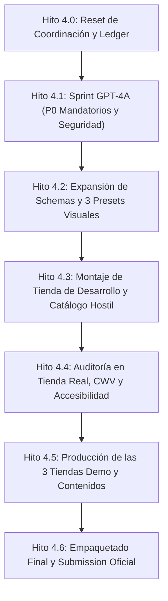

# Plan Maestro de Fase 4: Ruta Crítica, Dependencias y Dueños

```text
Fase: Phase 4 (QA, Presets, Tienda de Desarrollo y Preparación Theme Store)
Director del Proyecto: Johandry
Arquitecto y Coordinador: Gemini Flash 3.8 High
Auditor Senior UX y Editorial: Claude (Opus 5)
Implementador Técnico: GPT-5.6 Sol Max
Fecha de inicio: 2026-09-13
Meta final: Paquete validado para Shopify Theme Store Submission ($380–$400 tier)
```

---

## 1. Las 4 Decisiones Bloqueantes de Johandry (Fecha Límite: Antes del Empaquetado)

Estas decisiones pertenecen exclusivamente a Johandry. Ningún agente de IA puede inventarlas ni sustituir su autoridad:

| # | Decisión Requerida | Impacto en Theme Store | Estado y Resolución de Johandry |
| :--- | :--- | :--- | :--- |
| **D1** | **Nombre definitivo del tema y su preset principal** | **Bloqueante de empaquetado.** Shopify exige que uno de los presets comparta el nombre del tema. | **CERRADA (2026-09-13):** Opción A seleccionada. Tema: `"Couture"`. Presets: `Couture` (default), `Studio`, `Archive`. |
| **D2** | **Entidad comercial (`theme_author`)** | **Bloqueante de ficha oficial.** No se admiten handles personales de GitHub. | **CERRADA (2026-09-13):** Autor comercial formal: `"Ruiz Digital"`. |
| **D3** | **URLs oficiales de soporte y documentación** | **Bloqueante de submission.** Prohibido enlazar a repos o issues de GitHub. | **CERRADA (2026-09-13):** Configurado a `https://ruizdigital.com/themes/couture/docs` y `https://ruizdigital.com/themes/couture/support`. |
| **D4** | **Titularidad y privacidad del repositorio** | **Comercial / IP.** Actualmente en repo público de GitHub (`Noobprobro-web/Tema-Shopify`). | **ABIERTA:** Migrar a organización privada o repo de empresa antes del lanzamiento comercial. (Límite: Hito 4.5). |

---

## 2. Ruta Crítica de Fase 4 (Secuencia y Dependencias)



---

## 3. Desglose de Hitos, Entregables y Dueños con Nombre Propio

### Hito 4.0: Infraestructura de Coordinación (COMPLETADO)
- **Entregables:** `docs/requirements-ledger.md`, `agent-comms/status.md` reescrito con 2 métricas, Definition of Done de 5 compuertas en `AGENTS.md`.
- **Dueño:** Gemini Flash 3.8 High (revisado con Johandry y Claude).

### Hito 4.1: Sprint GPT-4A (P0 Mandatorios de Theme Store y Seguridad)
- **Alcance cerrado:**
  1. Selectores de país/moneda e idioma (`form 'localization'`) en footer y header móvil.
  2. Búsqueda predictiva accesible (`<predictive-search>` consumiendo `/search/suggest`).
  3. Formulario de newsletter en storefront (`form 'customer'`) y sección `sections/newsletter.liquid`.
  4. Iconos de pago en footer (`shop.enabled_payment_types`).
  5. Carga de scripts para modelos 3D (`shopify-xr.js`, `model-viewer-ui`).
  6. Metadatos sociales completos (Open Graph y Twitter Cards).
  7. Fix de comas decimales en filtros de precio + `step="any"` + escapado de atributos HTML.
  8. Corrección de contraste en botones `aria-busy` y bordes de inputs.
- **Dueños:** GPT-5.6 Sol Max (implementación) | Gemini (auditoría contra ledger vivo).

### Hito 4.2: Experiencia Visual, Hero, Galería y Expansión de Presets (Sprint GPT-4B)
- **Alcance cerrado:**
  1. `hero-editorial.liquid`: Modo Dual (Split Editorial vs Cinematic Full-Bleed con video, overlay y alineaciones).
  2. Galería de PDP: Carrusel táctil con `scroll-snap` nativo y dots/contador en móvil; apilado o thumbnails en desktop.
  3. Controles de espaciado por sección (`padding_top`, `padding_bottom`).
  4. Ampliación de `settings_schema.json` con los 8 tokens clave (ratio de tarjeta, border thickness, heading tracking, button style).
  5. Configuración de los 3 presets en `settings_data.json`: *Couture*, *Studio*, *Archive*.
- **Dueños:** Claude (blueprint y especificación) | GPT-5.6 Sol Max (código) | Gemini (revisión y validación).

### Hito 4.3: Tienda de Desarrollo Real y Catálogo Hostil
- **Alcance cerrado:**
  1. Crear tienda de desarrollo en Shopify Partners (`atelier-flow-demo.myshopify.com`).
  2. Conectar repositorio vía Shopify CLI (`shopify theme dev` o `shopify theme push`).
  3. Cargar catálogo de prueba deliberadamente hostil:
     - Producto con título de 120 caracteres.
     - Producto sin imagen.
     - Producto con imagen panorámica 21:9 y ultra vertical 2:5.
     - Vendor con comillas dobles (`"Designer's Cut"`).
     - Colección con 1 solo producto y colección vacía.
     - Producto con 40 variantes y combinación agotada.
     - Producto con modelo 3D y video.
     - Producto con Selling Plan / suscripción.
     - Tienda configurada en EUR con formato `1.234,56` y segundo mercado activo (ej. JPY).
- **Dueños:** Johandry (creación de tienda Partner) | Gemini (guía técnica y preparación de CSV/datos de catálogo).

### Hito 4.4: Auditorías en Vivo (Core Web Vitals, WCAG 2.2 AA y Navegación)
- **Alcance cerrado:**
  1. Correr el checklist de 18 pruebas de la sección 7 de `CLAUDE-AUDIT-001-review.md`.
  2. Medir Lighthouse Mobile en Home, PLP y PDP (mínimo 60 Performance, meta >= 85).
  3. Medir Lighthouse Accessibility (mínimo promedio 90, meta 100) y auditoría con axe DevTools.
  4. Prueba táctil en dispositivos físicos y 360px de ancho.
  5. Navegación exclusiva por teclado (Tab / Focus trap / Escape / Return focus).
- **Dueños:** Claude (auditoría UX/a11y) | Gemini (análisis técnico de trazas y CWV) | GPT (parches de optimización si aplican).

### Hito 4.5: Producción de las 3 Tiendas Demo Comerciales
- **Alcance cerrado:**
  - La Theme Store exige que cada preset cuente con una tienda demo funcional, con catálogo auténtico, fotografía con derechos y copy comercial original (prohibido Lorem Ipsum):
    - **Demo 1 (Couture - COMPLETADA EN COPY):** Entregada en `CLAUDE-DEMO-001` (marca ficticia *LINEA NOVE*, 24 productos, 6 colecciones y copy de 8 secciones). Pendiente curaduría de fotografía.
    - **Demo 2 (Studio):** Objetos de diseño / accesorios contemporáneos. 40-60 productos, fotografía de estudio 1:1, bento discovery, tipografía sans-serif. Redacción a cargo de Claude en Hito 4.5.
    - **Demo 3 (Archive):** Sastrería patrimonial / marroquinería / calzado artesanal. 20-35 productos, fotografía de archivo con grano, brand manifesto. Redacción a cargo de Claude en Hito 4.5.
- **Dueños Asignados:**
  - **Dirección de Arte y Curaduría de Fotografía con derechos:** Johandry.
  - **Redacción de Copy Auténtico y Fichas de Producto de Lujo:** Claude (Opus 5).
  - **Exportación técnica de contenido a `/listings/<preset-name>/`:** Gemini.

### Hito 4.6: Empaquetado Final y Submission Oficial
- **Alcance cerrado:**
  1. Comprobación final del Ledger: **44 / 44 filas cumplidas con evidencia**.
  2. Publicación de landing de documentación y soporte en `ruizdigital.com` con formulario/email activo y SLA <= 2 días (Dueño: Johandry / Ruiz Digital, Fecha límite: antes del paquete final).
  3. Ejecución de `shopify theme package`.
  4. Verificación de tamaño: `.zip` < 50 MB, archivos < 20 MB.
  5. Llenado del formulario oficial de Shopify Partners para Themes ($380–$400 tier).
- **Dueños:** Johandry (autorización final y envío a Shopify) | Gemini (generación y validación del paquete).
